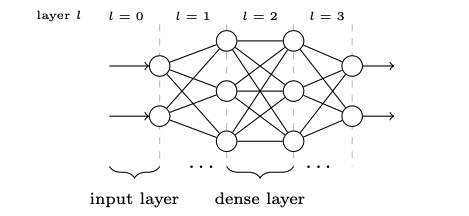
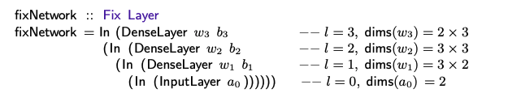
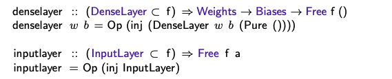

# UROP-2026
UROP project over summer 2026 about deep learning in haskell

Based on the paper 'Folding Over Neural Networks' : https://link.springer.com/chapter/10.1007/978-3-031-16912-0_5

### Intuition:

A neural network can be thought of as a sequence of layers. With that perspective,
it makes sense to consider forward and back propagation through the network as a 
fold in the respective direction. This is also possible with lists though (ignoring performance for now), so we 
want an elegant data structure which allows for an elegant API. It turns out there is a nice set of tools for doing this. 

### Background (Summary of the paper)

#### Functors and folding

A functor is something you can map over, i.e. apply the same function to every element inside.
E.g. `map (*2) [1,2,3] = [4,5,6]`. 

Our goal is to generalise recursion.

Consider a list: `List Int = Nil | Cons Int (List Int)`
This is recursive. Our goal is to remove the recursion from the type. So we can put it in another parameter: 

`ListF Int k = NilF | ConsF Int k` 
now `ListF Int` is also a functor: the function would just touch the `Int` in the `ConsF`, and do nothing in the `NilF`

Seems kind of useless but we'll introduce something else to capture the recursion instead: `Fix f = In (f (Fix f))`, so now 
`[6, 7] = In (ConsF 6 (In (ConsF 7 (In NilF))))`
See how the 'In' constructor generalised the recursion using the parameter k. 

Now that recursion has been generalised, we can also specify a very general way to fold and unfold over arbitrary types.
A catamorphism is this generalised fold. Look at a general Fix f structure:

`In (f     (In f (In f (...)))      )`

if we had an `f a -> a` function (an algebra), we could collapse the inside part recursively to get an `In (f a)`, then turn the 
`f a -> a` to get an `a` out. 

Similarly, an anamorphism is the generalised version of unfold: it would take a seed `b` and spit out a `Fix b`

#### NNs:
(Taking some stuff from the paper and putting it here):



Consider that network. We can represent layers like:

`data Layer k = InputLayer Values | DenseLayer Weights Biases k deriving Functor`

with Values and Biases being [Double], and Weights being a matrix [[Double]]

You can see how the network would be represented as the following:


There is no correctness problem with this, but it's ugly and annoying to write, and we'll fix it later.

Ignoring the mathematical details here, you can see how training would be a catamorphsim (a fold) followed
by an anamorphism (an unfold). The former would calculate the output, and the latter would build a new network
with the updated weights and biases. Repeating this many times would train it.

#### Improving Modularity
There are two problems right now (excluding the obvious one of performance):
1) Writing this many parentheses is annoying
2) I can't just reuse my DenseLayer in another type such as a CNN. It's fully connected to the Layer type

The first problem can be fixed with Free monads.

##### Free monad
`Fix` generalised recursion by giving us an infinite tree. Ours only had one branch because
we only had one `k` for the list example. Theoretically it could be many. However, the base case never
stored a value of type `a` itself - it was always an empty constructor.

The Free monad is similar, but it allows us to store values in the leaves:
`data Free f = Op (f (Free f a)) | Pure a`

Skipping the details, once we write the monad instance, the (>>=) operator then becomes equivalent to extending the structure at it's deepest level, so we can write the same network like this:

``` freeNetwork0 :: Free Layer a
    freeNetwork0 = do
        Op (DenseLayer w2 b2 (Pure ()))
        Op (DenseLayer w1 b1 (Pure ()))
        Op InputLayer 
```

##### Fixing Modularity
It would be good if we had all layers as different types, e.g. DenseLayer, InputLayer, (ConvLayer...) etc.
Then maybe we could say: 

`type FullyConnectedNetwork = DenseLayer :+: InputLayer` where :+: encoded some notion of choice of layers
i.e. every layer can be either an input layer or a dense layer

Fortunately, there is a way to do this. The :+: operator is called the 'coproduct', and hence
DenseLayer :+: InputLayer is the coproduct of two functors. The definition is as follows:

`data (f :+: g) a = L (f a) | R (g a) -- this requires some extensions to do but works`

So each DenseLayer is now actually an L (DenseLayer ...) and inputlayer is R (InputLayer). This operator
associates right so there is only one way to get to each one, R R ... L. Handling this ourselves would be annoying so we can define smart constructors which will use the types to decide exactly which combination of L and R to put in: 



The subset here just means it's in the coproduct, e.g. DenseLayer :<: DenseLayer :+: InputLayer

The result is a network definition looking like the following:

``` freeNetwork0 :: Free Layer a
    freeNetwork0 = do
        denseLayer w2 b2
        denseLayer w1 b1
        inputLayer
```
Tracing through all the definitions will give some insight. Essentially, the >> at each step
pushes the RHS into the Pure () of the LHS. The result is something like

`Op (lastLayer Op (penultimateLayer Op (... Op (inputLayer) ) ) )`

The forward and backprop algebras don't change too much. We just have to ensure we
provide one algebra for each type of layer, then it will pick the right one automatically via typeclasses.

##### OnlyFolds
Backprop currently is an anamorphism, but we can also represent it as a normal fold / eval.

The new backprop eval would then build up a function. Remember eval at each stage looks inside the rest
of the structure, does the result for that then applies the alg on the current layer. When we give the
initial backProp value, it will resolve the outermost lambda, creating a new layer, then pass the updated
backProp values as the new backProp to the next layer for the next lambda, creating the updated network
one layer at a time. However, note in practice that GHC won't build the entire function upfront, it will
execute lazily so it will end up threading the backProp values through (perhaps leaving the updated weights
and biases as thunks because we never force them).

It is possible to train only in a single fold by pairing up the forward and backward passes into one pair
structure, but it's quite obfuscated.


### My Changes

I extended the previous approach to improve upon the performance concerns, which there are plenty of. 

In a separate branch, I also (attempted) to add CNNs. It is 95% of the way there, but there's a few minor things
which need checking, because MNIST is not training properly for some reason. 

I also considered, as a prototype, adding stronger types to prevent incorrect dimension networks from being
impossible. This however is still in it's earlier stages, and isn't yet in the repo. 